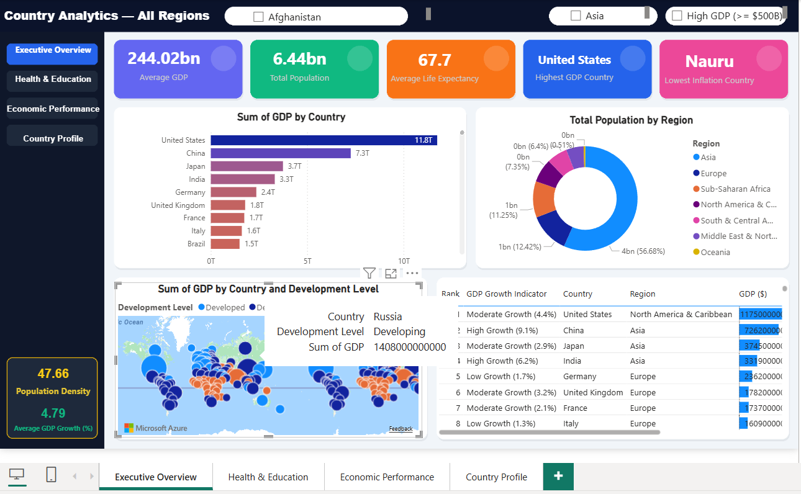
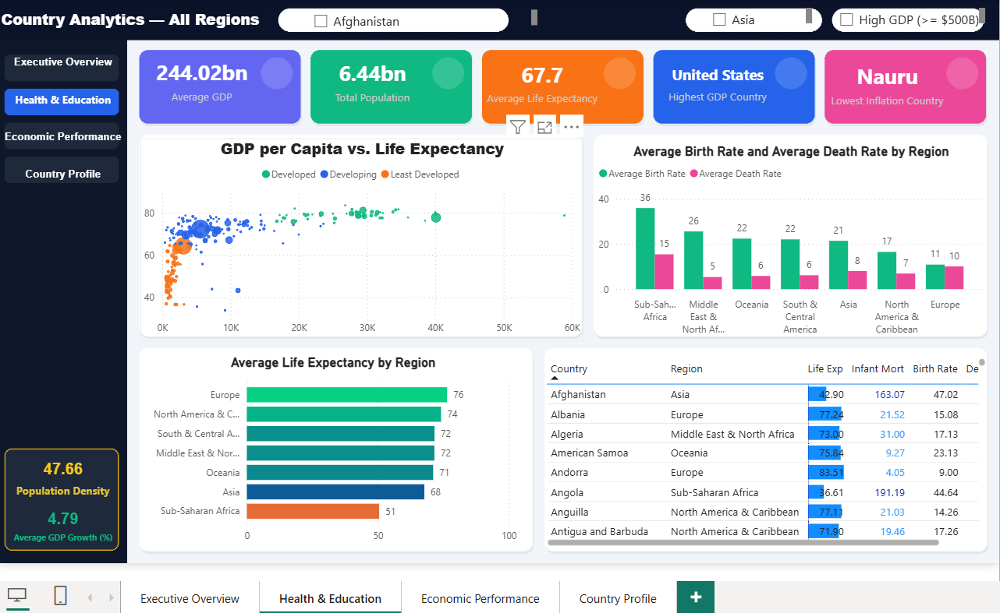
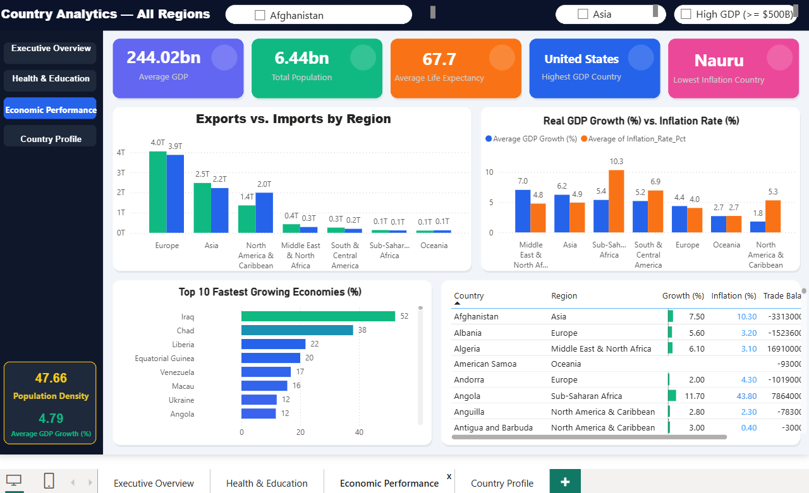
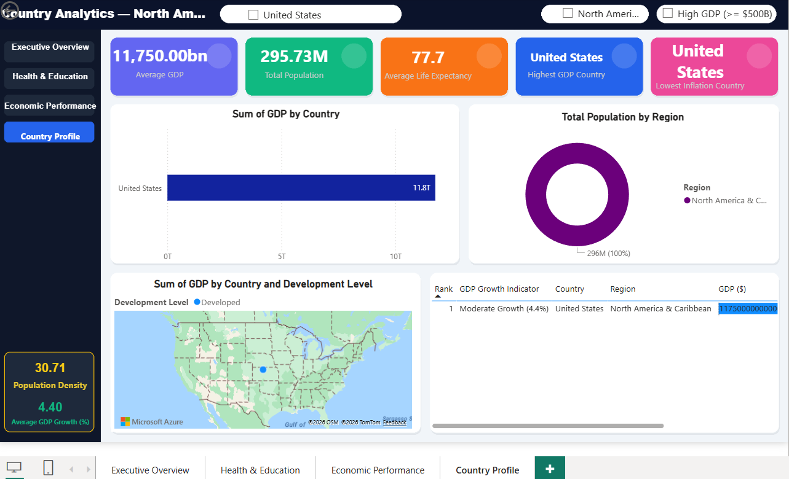
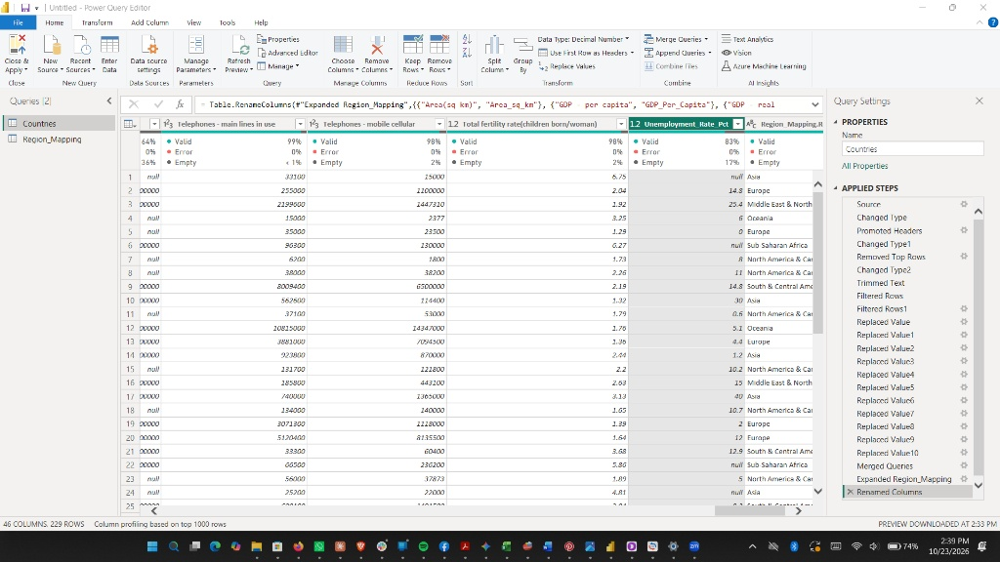
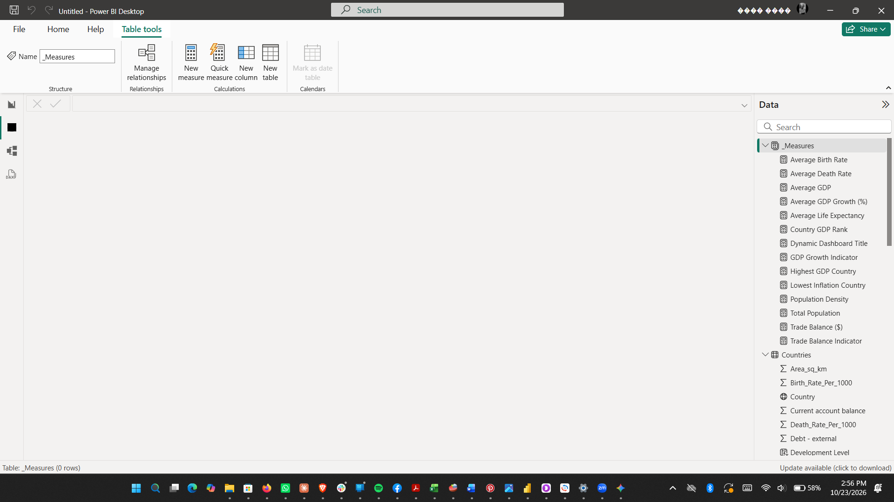

# Global Development & Economic Performance Dashboard (Power BI)

An interactive 4-page Power BI report that compares **229 countries and territories across 7 world regions** on economic output, health, demographics and trade. It covers the full analyst workflow: cleaning raw data in Power Query, modeling it, writing DAX measures, designing the dashboard, and turning the numbers into business recommendations.



## Key findings

| # | Insight | Evidence |
|---|---------|----------|
| 1 | **Global output is highly concentrated.** | The 20 economies with GDP ≥ $500B generate about 79% of the $55.6T total. The US ($11.75T), China ($7.26T), Japan ($3.75T) and India ($3.32T) lead. |
| 2 | **Income and longevity move together.** | GDP per capita vs. life expectancy: r = +0.60. Europe averages ~$21.4K per capita and 76.5 years; Sub-Saharan Africa ~$2.5K and 50.5 years. |
| 3 | **Regions are at very different demographic stages.** | Sub-Saharan Africa: 35.8 births vs. 15.4 deaths per 1,000. Europe: 10.9 births vs. 10.1 deaths per 1,000. |
| 4 | **Infant survival is the strongest health signal.** | Infant mortality vs. life expectancy: r = −0.89. Price instability also tracks with lower life expectancy (r = −0.32); Zimbabwe is the extreme case at 133% inflation, −8.2% growth and 36.7 years. |
| 5 | **Trade balances split exporters from consumers.** | Surpluses: Germany (+$176.6B), Japan (+$137.0B), Saudi Arabia (+$76.8B). Deficits: United States (−$681.0B), United Kingdom (−$92.2B). |

**Recommendations drawn from the analysis**
1. Prioritise maternal, infant and infectious-disease healthcare funding in Sub-Saharan Africa.
2. Tie development financing in high-inflation economies (inflation > 15%) to monetary stabilisation.
3. Direct export surpluses in fast-growing regions (MENA 7.0% and Asia 6.2% average growth) into energy, broadband and transport infrastructure.

## Dashboard pages

| Executive Overview | Health & Education |
|---|---|
|  |  |
| **Economic Performance** | **Country Profile (drill-through)** |
|  |  |

- Custom dark "SaaS" layout with a navigation sidebar and background images (`assets/backgrounds/`)
- 3 global slicers (Country, Region, GDP Category) and 5 KPI cards
- Azure Map of GDP by country and development level
- Right-click **drill-through** from any country to a dedicated profile page
- Dynamic dashboard title driven by the selected region

## What I built

### 1. Data cleaning (Power Query)
The raw file had 263 records across 45 columns. Six issues were fixed:

| Step | Issue | Fix |
|---|---|---|
| 1 | Semicolon (`;`) delimiter | Set the CSV delimiter and promoted the first row to headers |
| 2 | Schema metadata in row 2 (`String;double;…`) | Removed the top row and re-detected data types |
| 3 | `#European Union` aggregate row | Filtered it out to avoid double-counting $11.65T of GDP and 457M people |
| 4 | Uninhabited territories with empty GDP / population | Filtered out, leaving 229 countries and territories |
| 5 | Inconsistent country names | Standardised 11 names (e.g. *Bahamas, The* → *Bahamas*, *Burma* → *Myanmar*) so Azure Maps recognises every location |
| 6 | No region column | Merged with [`Region_Mapping.csv`](data/Region_Mapping.csv) to add 7 world regions |



### 2. Data model
- `Country` set as Country/Region and `Region` as Continent, with a **Region → Country hierarchy** for drill-down
- Columns grouped into display folders: Economic, Health, Population and Trade indicators
- Four DAX calculated columns:

| Column | Logic |
|---|---|
| GDP Category | High (≥ $500B) · Medium ($50B–$500B) · Low (< $50B) |
| Population Category | Large (≥ 50M) · Medium (10M–50M) · Small (< 10M) |
| Development Level | Developed (GDP/capita ≥ $15K **and** life expectancy ≥ 75) · Developing · Least Developed |
| Growth Indicator Category | High (≥ 5%) · Moderate (2–5%) · Low (0–2%) · Negative (< 0%) |

### 3. DAX measures
14 measures live in a dedicated `_Measures` table, using `SUM`, `AVERAGE`, `CALCULATE`, `DIVIDE`, `IF`, `FILTER`, `TOPN` and `RANKX`. Examples:

```DAX
Population Density =
DIVIDE ( SUM ( 'Countries'[Population] ), SUM ( 'Countries'[Area_sq_km] ), 0 )

Trade Balance ($) =
SUM ( 'Countries'[Exports] ) - SUM ( 'Countries'[Imports] )

Country GDP Rank =
IF (
    HASONEVALUE ( 'Countries'[Country] ),
    RANKX (
        FILTER ( ALLSELECTED ( 'Countries' ), NOT ( ISBLANK ( 'Countries'[GDP] ) ) ),
        CALCULATE ( SUM ( 'Countries'[GDP] ) ), , DESC, Dense
    )
)

Dynamic Dashboard Title =
"Country Analytics — " & SELECTEDVALUE ( 'Countries'[Region], "All Regions" )
```

The full measure reference is in [`docs/Documentation_and_Insights_Report.docx`](docs/Documentation_and_Insights_Report.docx).



## Repository structure

```
├── dashboard/   Power BI report (.pbix)
├── data/        Cleaned dataset + region mapping (CSV)
├── docs/        Full documentation & insights report, presentation (PPTX + PDF)
├── images/      Dashboard and process screenshots
└── assets/      Background images used in the report design
```

## How to open

1. Install the free [Power BI Desktop](https://powerbi.microsoft.com/desktop/).
2. Open `dashboard/Country_Development_Dashboard.pbix`.
3. If Power BI asks for the data source, point it to `data/Country_Data_Cleaned_PowerBI.csv`.

## Skills demonstrated

Power BI · Power Query (M) · DAX · Data modeling · Data cleaning · Dashboard & UX design · Azure Maps · Drill-through · Statistical analysis · Business storytelling

## Notes on the data

`data/Country_Data_Cleaned_PowerBI.csv` is the cleaned output (229 countries and territories). The original raw file is not redistributed here. Figures come from that dataset and reflect its reference year, so treat them as a snapshot, not current statistics.

## Author

**Atef Khalaf** — Junior BI Analyst, Business Information Systems, Faculty of Commerce, Menoufia University.
